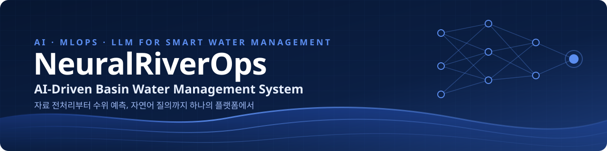
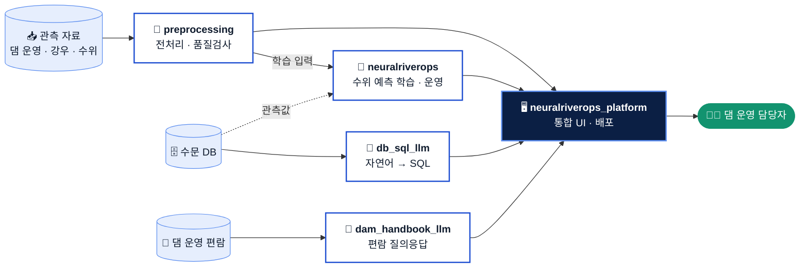

  

  
  
  
  
  
  
  

  <b>AI-Driven Basin Water Management System — 유역 댐 운영을 돕는 AI 플랫폼입니다.</b> 
  관측 자료를 정리하고, 댐 하류 수위를 예측하는 모델을 학습·운영하며, 
  수문 DB와 댐 운영 편람에 <b>우리말로 묻고 답할 수 있는</b> 도구를 하나의 화면으로 묶었습니다.

---

## 🌊 한눈에 보기

---

## 📦 저장소

<table>
<tr>
<td width="50%" valign="top">

### 🖥️ [neuralriverops_platform](https://github.com/neuralriverops/neuralriverops_platform)
**네 시스템을 하나로 묶는 통합 플랫폼**

- 전처리 → 학습·예측 → DB 질의 → 댐 핸드북을 **탭 하나씩**으로 제공하는 웹 UI
- Keycloak 계정 하나로 모든 기능에 로그인
- 관측소 네트워크(상류 → 하류) 위에서 학습·예측 진행 상황을 실시간으로 표시
- `make up` 한 번으로 전체 시스템을 컨테이너로 실행

Dash · Docker Compose · Keycloak

</td>
<td width="50%" valign="top">

### 🧠 [neuralriverops](https://github.com/neuralriverops/neuralriverops)
**댐 하류 수위 예측 MLOps**

- 딥러닝(LSTM) 모델로 댐 방류에 따른 **하류 관측소 수위**를 예측
- 재학습 → 평가 → 모델 승격(champion / challenger)까지 자동화
- 학습 자료 버전, 모델 카드, 성능 비교를 MLflow에 기록
- 예측 결과를 관측과 비교해 재학습이 필요한 관측소를 알려 주는 모니터링
- 예측 결과를 LLM이 요약한 **보고서** 생성

NeuralHydrology · MLflow · FastAPI · SeaweedFS · Kubernetes

</td>
</tr>
<tr>
<td width="50%" valign="top">

### 🧹 [preprocessing](https://github.com/neuralriverops/preprocessing)
**관측 자료 전처리와 품질검사(QC)**

- 댐 운영·강우·수위 CSV를 공통 시간축으로 정리
- 결측 · 이상치를 찾아 표시하고 보정, QC 보고서와 그림 생성
- 지도에서 유역 안 관측소를 골라 학습 입력 자료로 저장
- 새 연도 자료 검토, 관측소별 학습/검증/시험 기간 설정
- 오토인코더 기반 **결측 보정**

pandas · Spark · 웹 UI

</td>
<td width="50%" valign="top">

### 💬 [db_sql_llm](https://github.com/neuralriverops/db_sql_llm)
**수문 DB 자연어 질의 에이전트 (NL2SQL)**

- “A댐의 2023년 평균 유입량은?” 처럼 **우리말로 질문**하면 SQL을 만들어 실행
- 숫자는 **실제 SQL 결과에서만** 답하고, 실행한 SQL과 결과 표를 함께 보여 줌
- 자료가 없는 기간이면 대안 기간과 자료 충족률을 안내
- 읽기 전용 실행과 SQL 검사로 DB를 안전하게 보호
- 틀린 답에 대한 피드백 → 지식 위키 개선 → 회귀 평가로 점점 정확해짐

FastAPI · sqlglot · PostgreSQL + pgvector · vLLM

</td>
</tr>
<tr>
<td colspan="2" valign="top">

### 📖 [dam_handbook_llm](https://github.com/neuralriverops/dam_handbook_llm)
**댐 운영 편람 질의응답**

- 「물관리 실무편람」을 LLM이 찾아 읽기 좋은 **위키**(문서 · 장 · 표 · 값 색인)로 정리
- 모델이 위키를 직접 조회해 **출처와 함께** 답하고, 위키에 없으면 “확인 불가”라고 답함
- 값 조회 · 조건 필터 · 목차 · 검색 도구를 MCP 서버로 제공
- 정확도 평가 문항으로 답변 품질을 꾸준히 점검

vLLM · MCP · opencode · Node Chat UI

</td>
</tr>
</table>

---

## 🔄 이렇게 쓰입니다

| 단계 | 하는 일 | 담당 저장소 |
|:---:|---|---|
| **1** | 새로 들어온 관측 자료를 정리하고 품질을 점검합니다 | 🧹 preprocessing |
| **2** | 정리된 자료로 수위 예측 모델을 다시 학습하고, 더 나은 모델을 운영 모델로 승격합니다 | 🧠 neuralriverops |
| **3** | 댐 방류 시나리오에 따라 하류 수위를 예측하고 보고서를 받습니다 | 🧠 neuralriverops |
| **4** | 궁금한 관측 현황은 DB에, 운영 기준은 편람에 우리말로 바로 묻습니다 | 💬 db_sql_llm · 📖 dam_handbook_llm |
| **5** | 이 모든 과정을 한 화면에서, 한 계정으로 진행합니다 | 🖥️ neuralriverops_platform |

---

## 🛠️ 기술 스택

| 영역 | 사용 기술 |
|---|---|
| 예측 모델 | NeuralHydrology (LSTM), PyTorch |
| MLOps | MLflow (실험 · 모델 레지스트리), SeaweedFS (S3), Kubernetes Job · Kubeflow Pipelines |
| LLM | vLLM 로컬 모델, Claude API (보고서), MCP 도구 서버 |
| 데이터 | PostgreSQL · pgvector, pandas, Spark |
| 서비스 · UI | FastAPI, Dash, Node |
| 인증 · 배포 | Keycloak (OIDC), Docker Compose |

---

  🔒 각 저장소는 비공개로 운영됩니다. 접근이 필요하면 조직 관리자에게 문의해 주세요. 
  AI-Driven Basin Water Management System · 유역 댐 운영 AI 연구

